> **테스트 글입니다.** [🩺 부상 에세이](../injury-essay/)와 내용과 숫자는 같고, 말투만 가볍게 바꾼 뒤 짤을 넣었어요. 느낌을 보기 위한 임시 글이라 발행하지 않습니다.

결론부터 말씀드립니다. **범인은 한 명이 아닙니다.** 넷이에요. 공범입니다.

무슨 얘기냐면요.

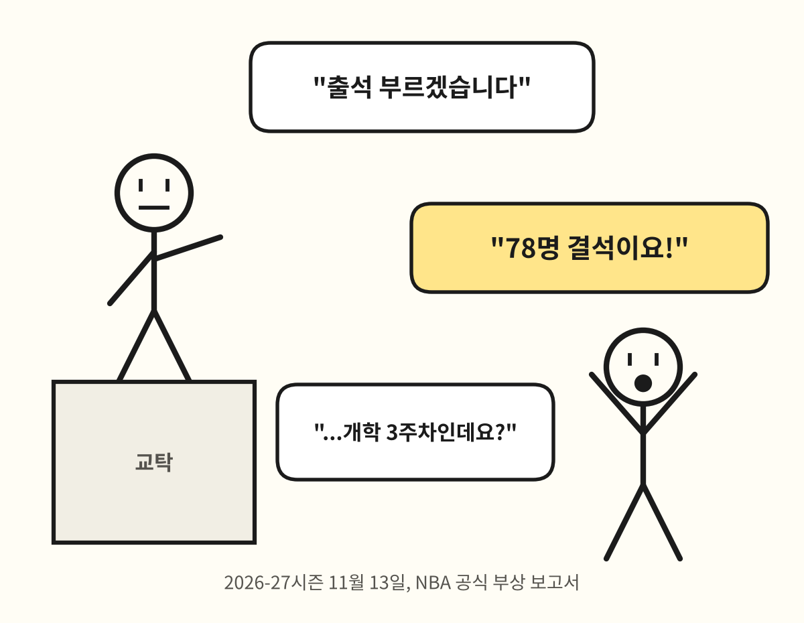

11월 13일 기준, NBA 공식 부상 보고서에 Out으로 올라간 선수가 **78명**입니다. 한 팀 로스터가 15명 남짓이니까 **다섯 팀이 통째로 사라진 셈**이에요. 개막한 지 3주 됐습니다. 3주요.

11월 11일에는 Stephen Curry가 3점을 넣고 옆구리를 잡았고(복사근 파열, 2주 뒤 재검진), 같은 날 Lauri Markkanen은 오른손 골절 두 곳이 확인됐습니다(4주 뒤 재검진). 그 앞에는 Edwards, Haliburton, Kawhi, Banchero, Jaren Jackson Jr., Holmgren, Morant, Duren이 줄을 서 있고요. 명단만 읽어도 숨이 찹니다.

그래서 다들 묻습니다. **"아니, 요즘 왜 이렇게 많이 다쳐?"**

오늘은 이 질문을 끝까지 파 봅니다. 다친 선수들 얘기로 웃지는 않을게요. 웃음은 리그와 일정표와 숫자 싸움에서만 찾겠습니다.

## 1. 일단 숫자부터 (도망가지 마세요, 금방 끝나요)

- **11월 11일까지 부상으로 사라진 경기: 767 선수·경기** (선수 한 명이 한 경기 빠지면 1)
- Out 등록 인원: **11월 9일 89명**으로 최고, 두 주 동안 75명 밑으로 내려간 날이 없음
- 부위별 1위: **무릎 221**. 2위 발목(92)의 두 배가 넘습니다

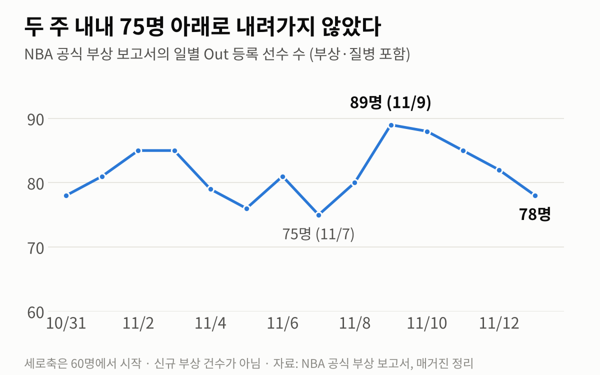

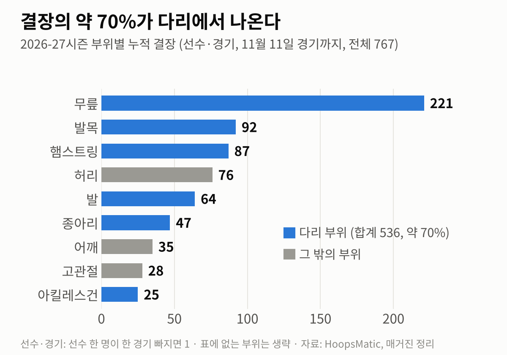

무릎, 발목, 햄스트링, 발, 종아리, 아킬레스건을 더하면 536입니다. **전체의 약 70%가 다리**예요. 농구는 손으로 하는 운동인 줄 알았는데, 청구서는 다리로 날아옵니다.

자, 여기서 "역대 최악!"이라고 외치고 싶죠? 저도요. 근데 **못 외칩니다.**

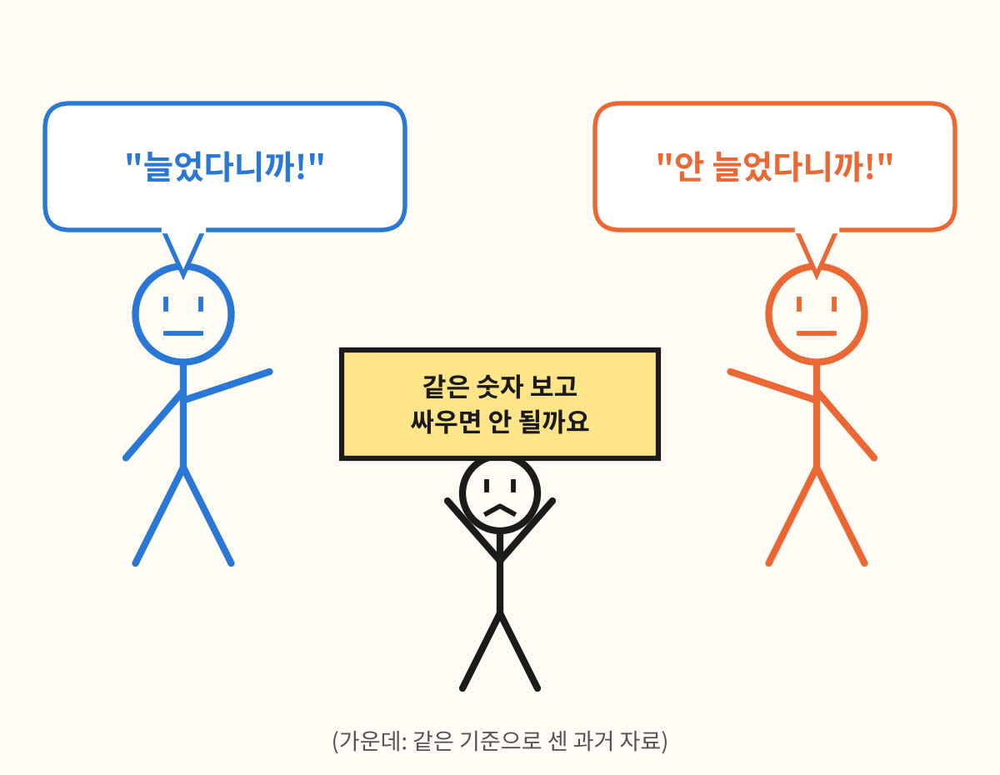

이유는 단순합니다. **같은 기준으로 센 옛날 숫자가 없어요.**

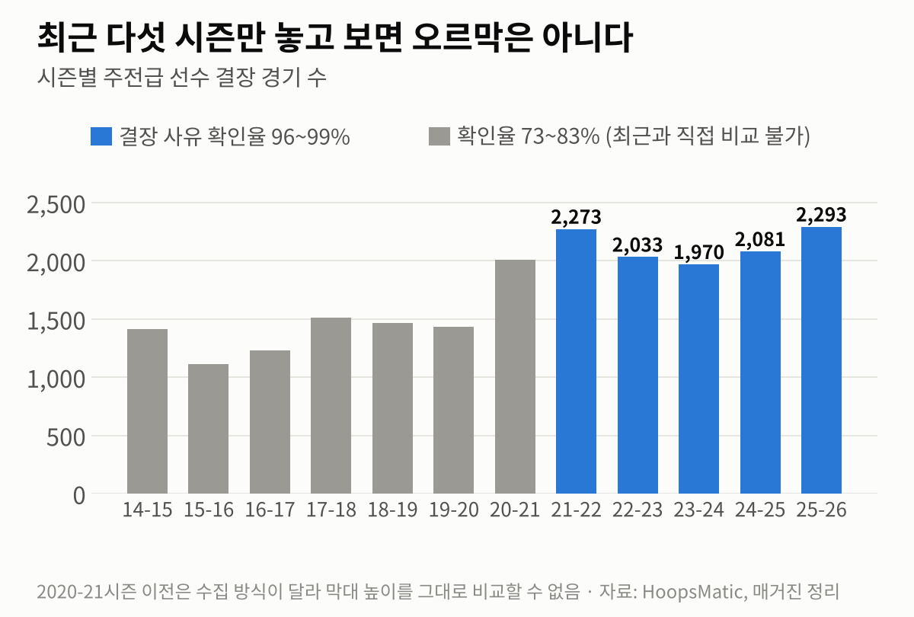

주전급 결장 경기는 2023-24시즌 1,970경기에서 2025-26시즌 2,293경기로 두 해 사이 약 16% 늘었습니다. 오, 늘었네? 싶은데 2021-22시즌도 2,273경기였어요. 오르막이 아니라 **출렁다리**입니다. 그리고 회색 막대(2020-21시즌 이전)는 결장 사유가 확인된 비율이 73~83%밖에 안 돼서, 지금(96~99%)이랑 나란히 놓으면 반칙이에요. 체중계를 바꿔 놓고 "살 빠졌다"고 하는 격입니다.

리그 쪽 연구도 비슷합니다. 2014-15시즌부터 2018-19시즌까지 결장으로 이어진 부상 발생률은 1만 선수·분당 5.6~7.0건으로 사실상 제자리였어요. 지난 시즌에는 "스타들 결장이 개막 15경기 기준 213경기, 두 시즌 전(100경기)의 두 배"라는 집계와 "전체 부상 건수는 안 늘었다"는 분석이 **동시에** 나왔습니다. 둘 다 맞는 말이에요.

정리하면 이렇습니다.

- 전체 부상이 늘었다? → **아직 증명 안 됨**
- 스타들이 빠지는 경기가 늘었다? → **여러 자료가 그렇다고 함**
- 그 부담이 다리 근육·힘줄에 몰린다? → **그렇다고 함**

"몇 건 다쳤냐"보다 "얼마나 오래 빠지냐"의 문제라는 거죠.

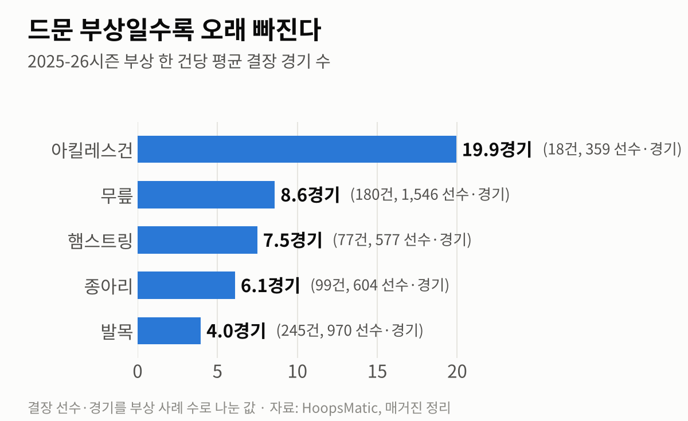

지난 시즌 기준으로 발목은 245건이나 나왔는데 한 건에 4경기쯤 쉬고 돌아옵니다. 감기 같은 부상이에요. 아킬레스건은 18건뿐인데 **한 건에 약 20경기**가 날아갑니다. 자주 오는 손님보다 가끔 오는 손님이 가게를 뒤집어 놓는 구조입니다.

자, 이제 용의자를 한 명씩 불러 봅시다.

## 2. 용의자 1번: 스텝백 (멋있는 건 비싸다)

요즘 농구의 필살기를 떠올려 보세요. 게더 스텝, 스텝백, 유로스텝. 공통점이 있습니다. **전속력으로 달리다가 한 발로 급정거**한다는 거예요.

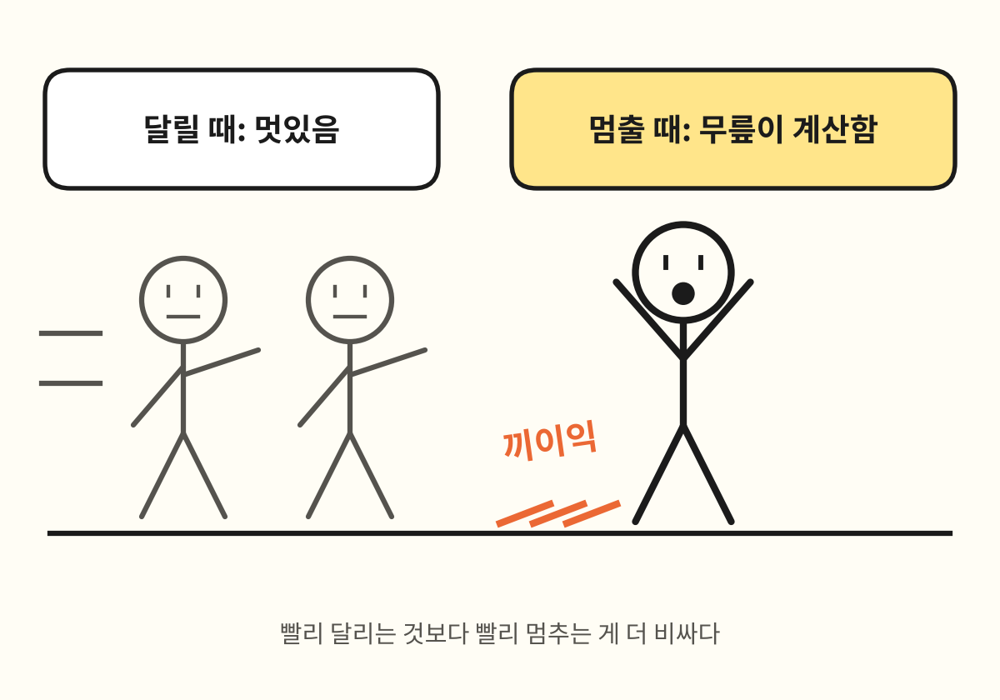

자동차도 그렇잖아요. 엔진보다 브레이크 패드가 먼저 닳습니다. 몸에서는 그 브레이크 패드가 무릎이고 발목이고 햄스트링이에요.

그리고 이 급정거, 진짜로 늘었습니다.

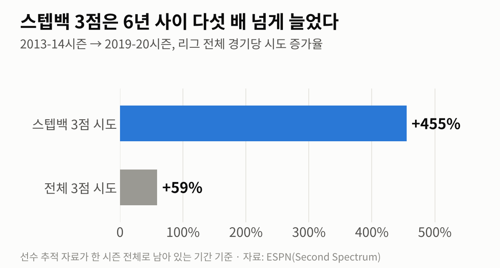

2013-14시즌부터 2019-20시즌까지 전체 3점 시도가 59% 늘 때 **스텝백 3점은 455% 늘었습니다.** 오타 아니에요. 사백오십오입니다.

부상 쪽 정황도 있어요. 2024-25시즌에 나온 아킬레스건 파열 7건의 영상을 돌려 봤더니, 7건 모두 출발 직전에 발을 뒤로 짧게 딛는 동작 뒤에 일어났다는 보도가 있었습니다. 30년 치(1995~2024년) 공개 부상 기록을 본 올해 학회 발표도 같은 방향이에요.

| 부위 | 늘어난 시기 | 발생률비 |
|---|---|---|
| 아킬레스건 | 핸드체킹 금지(2004년) 이후 | 1.51 |
| 햄스트링 | 페이스 앤 스페이스 시기(2011~2019년) | 1.28 |
| 종아리 | 페이스 앤 스페이스 시기(2011~2019년) | 1.55 |

(발생률비 1.51 = 비교 시기보다 약 1.5배 자주 일어났다는 뜻)

**그럼 범인 확정?** 아직입니다. "스텝백이 늘었다"와 "부상이 늘었다"가 따로 있을 뿐, **스텝백을 많이 하는 선수가 더 많이 다친다**는 걸 직접 이어 주는 자료는 없어요. 알리바이가 애매한 거죠. 게다가 Markkanen의 골절은 상대 손에 맞아서 생겼습니다. 리그 연구로는 결장 부상의 73%가 급성이고, 그중 절반 가까이는 다른 선수와 부딪혀서 나요. 스텝백이 손뼈까지 부러뜨리지는 않습니다.

**판정: 유력 용의자. 단독 범행은 아님.**

## 3. 용의자 2번: 주행거리 (스무 살인데 엔진은 서른 살)

두 번째는 "오래 뛰어서"입니다. 지금 리그의 얼굴들은 정말 오래 정상에 있어요. Curry가 38세입니다.

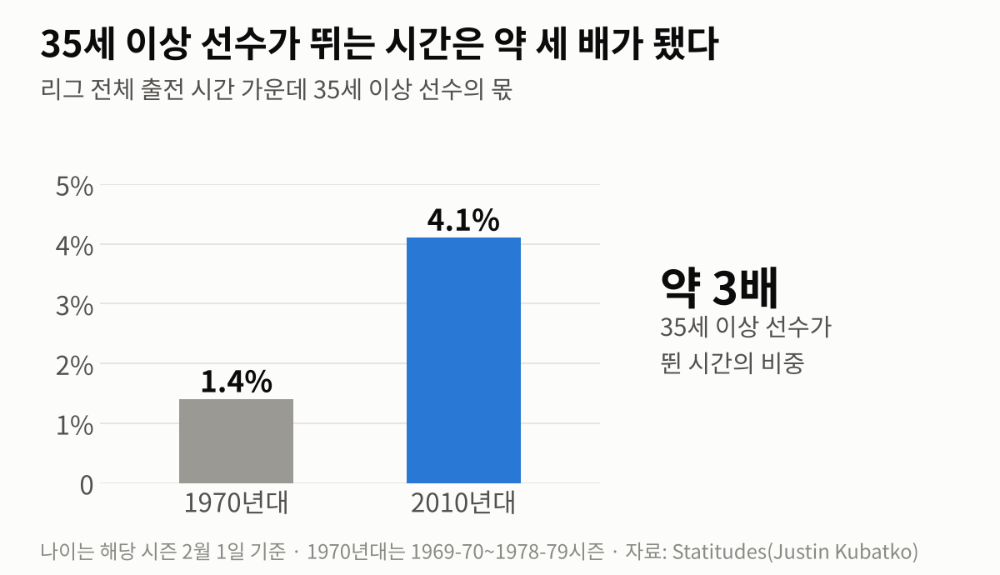

35세 이상 선수가 뛰는 시간은 1970년대 1.4%에서 2010년대 4.1%로 약 세 배가 됐습니다. 형님들이 안 내려오세요.

"아, 그럼 나이 든 스타들이 다치는 거구나!" 하면 깔끔한데, 올해 명단을 보면 **20대 초중반이 수두룩**합니다. 여기서 UCSF의 정형외과 의사 Nirav Pandya가 등장합니다. 이분 말로는 아킬레스건과 햄스트링 부상이 예전에는 커리어 막바지에 오던 부상인데, 이제는 젊은 선수에게 온다는 거예요. 이유는 어릴 때부터 1년 내내 농구만 하는 조기 전문화.

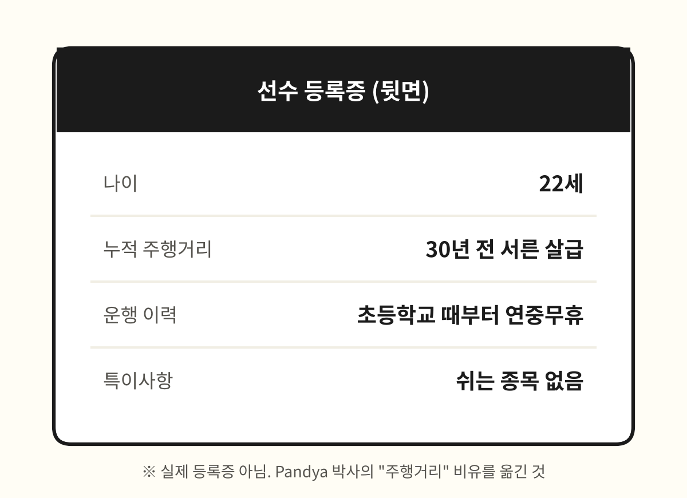

**지금의 스무 살은 30년 전의 스무 살보다 이미 더 많이 뛴 몸**이라는 겁니다. 연식은 새 차인데 계기판은 이미 많이 돌아가 있는 거죠. Adam Silver 총재도 지난 시즌에 부상 원인으로 경기 속도와 함께 유소년 농구의 빡빡한 일정을 직접 언급했습니다.

숫자로 보면 이렇습니다.

| 항목 | 숫자 |
|---|---|
| 아킬레스건 파열 선수의 평균 나이 (2013년 연구) | 29.7세 |
| 아킬레스건 파열 선수의 평균 나이 (최근 집계) | 27세 |
| 2024-25시즌 아킬레스건 파열 | 7건 (그전 한 시즌 최다는 4건) |
| 2025 플레이오프에서 파열된 세 선수의 나이 | 25세, 27세, 34세 |
| 현역 선수 590명 중 AAU 농구 경험자 | 84.7% |

2014-15시즌부터 2024-25시즌까지의 아킬레스건 파열을 분석한 연구는 더 구체적이에요. 베테랑은 누적 부담이 무거운 상태에서 파열됐고, **젊은 선수는 더 가벼운 출전량에서도 파열됐습니다.** 물론 리그는 "출전 시간과 아킬레스건 부상 사이에 관계를 못 찾았다"고 반박했고, 2025-26시즌에는 파열이 한 건뿐이었어요. 한 시즌 튄 걸로 추세라고 하긴 이릅니다.

**판정: "늙어서"가 아니라 "쌓여서". 죄목 변경.**

## 4. 용의자 3번: 일정표 (82경기는 억울하다)

가장 많이 지목당하는 분입니다. "82경기가 너무 많다!" 근데 이분, 의외로 알리바이가 있어요.

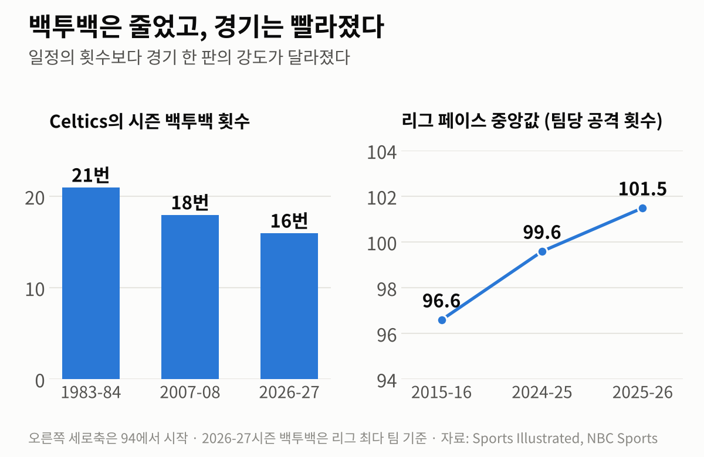

백투백은 **오히려 줄었습니다.** 1983-84시즌 Celtics가 21번, 2007-08시즌 18번, 올 시즌 리그 최다인 Celtics가 16번이에요. Larry Bird 시절이 더 빡셌다는 얘기죠. 심지어 NBA가 2024년에 30개 구단에 돌린 57쪽짜리 보고서는 "쉬게 한다고 부상 위험이 줄어든다는 근거를 못 찾았고, 일정이 빡빡한 구간에 부상률이 높지도 않았다"고 적었습니다. (연구진은 "휴식이 소용없다는 뜻은 아닙니다"라고 급히 덧붙였어요.)

그럼 무죄냐. 그건 또 아닙니다. 바뀐 건 경기 수가 아니라 **경기 한 판의 무게**예요. 지난 시즌 초반 선수들의 이동 거리와 평균 속도는 2013-14시즌 측정을 시작한 뒤로 가장 높았고, 리그 페이스는 1988-89시즌 이후 가장 빨랐습니다. 같은 82경기인데 한 경기가 예전보다 무거운 거죠. 메뉴판 가격은 그대로인데 양이 늘어난 식당이라고 하면 좋은 얘기 같지만, 먹는 쪽이 선수들 무릎이라 문제입니다.

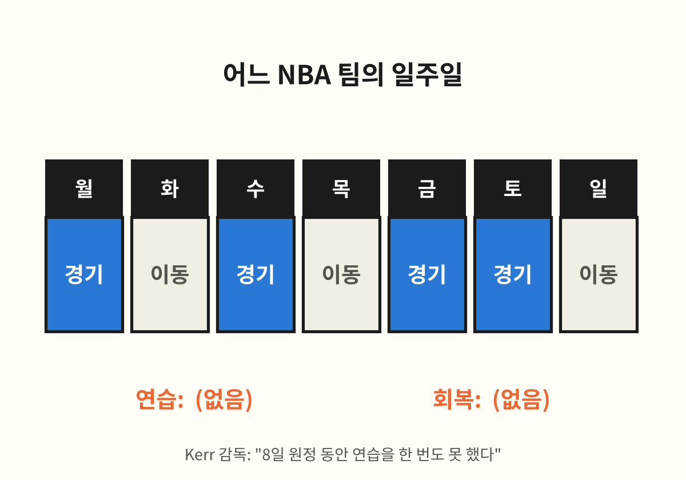

Steve Kerr 감독의 말이 핵심입니다. 예전에는 닷새에 네 경기를 몰아 치르는 대신 그 뒤에 나흘을 쉬었대요. 지금은 몰아치는 구간을 없앤 대신 **이틀에 한 번꼴로 끝없이** 이어집니다. 쉴 날도, 훈련할 날도 없어요.

**판정: "많아서"가 아니라 "빽빽해서". 역시 죄목 변경.**

## 5. 용의자 4번: 개막 (준비 운동 없이 수영장에 뛰어들기)

마지막 용의자는 타이밍입니다. 생각해 보세요. 누적 피로가 문제라면 3월에 터져야지, **왜 개막 3주 차에 터질까요?**

Pandya는 개막 직후 부상이 느는 건 NBA, NFL, NHL 다 그렇다고 합니다. 몸이 실전 속도에 다시 적응하는 시기라서요. 리그 연구에서도 결장 부상 발생률이 가장 높은 구간은 정규시즌이 아니라 **프리시즌 경기**였습니다.

그런데 그 준비 구간이 점점 얇아져요. 프리시즌 경기는 줄었고, 오프시즌 훈련은 풀코트 실전보다 개인 기술 위주로 바뀌었습니다. 반면 개막전 속도는 해마다 빨라지고요. 여름 내내 드리블 연습만 하다가 10월에 갑자기 시속 100km로 달리라는 겁니다. 준비 운동 없이 수영장에 뛰어들면 쥐가 나죠.

수비도 한몫합니다. 다섯 명이 다 3점을 쏘니까 수비수는 25피트 밖까지 뛰어나갔다가 급정거해야 해요. 용의자 1번의 "급정거"는 공격수만의 일이 아니었습니다. (1번과 4번이 아는 사이였네요.)

**판정: 시즌 초반 사건의 가장 유력한 공범.**

## 6. 수사 결과: 공범 넷

정리합니다.

**농구는 더 빠르고 넓어져서 급정거 한 번이 비싸졌고(1번), 선수들은 어릴 때부터 쌓인 주행거리를 안고 들어오며(2번), 무거워진 경기를 쉴 틈 없이 이틀에 한 번 치르고(3번), 그 강도를 준비할 시간도 없이 개막을 맞습니다(4번).**

넷이 만나는 지점에서 사고가 납니다. 한 명만 잡아서는 안 끝나요.

솔직히 말하면 이건 "가장 그럴듯한 추리"지 확정판결은 아닙니다. 결정적 증거(선수별 부상 기록, 움직임 추적 원자료)는 리그와 구단 금고 안에 있거든요. 바깥에서는 CCTV 없이 정황만 맞춰 본 겁니다.

## 7. 그래서 어떻게 하자는 건데

한 줄로 줄이면 이겁니다. **경기를 줄이지 말고, 경기와 경기 사이를 고치자.**

**① 총량 말고 간격.** 82경기를 줄이자는 건 속은 시원한데 근거가 약하고, 돈이 걸려 있어서 될 리가 없어요. 대신 같은 82경기를 더 긴 기간에 펼쳐서 백투백을 없애고 경기 사이에 24~48시간을 보장하는 건 됩니다. 시즌을 조금 일찍 열거나 늦게 닫으면 돼요. 스타가 더 많이 나오니 리그도 손해가 아니고요.

**② 시즌 입구 넓히기.** 가장 많이 다치는 구간이 프리시즌과 개막 직후라면, 준비 기간을 줄일 게 아니라 준비와 실전의 낙차를 줄여야죠. 캠프를 늘리고, 풀코트 실전 훈련을 단계적으로 쌓고, 개막 초반에는 백투백과 긴 원정을 덜 넣는 겁니다.

**③ 단체 휴가 말고 맞춤 관리.** 건강한 선수를 일괄로 쉬게 하는 건 효과가 확인되지 않았어요. 위험 요인으로 꼽힌 건 나이, 과거 부상, 수술 이력입니다. 그러면 "팀 전체 휴식일"이 아니라 "이 선수의 이력과 지금 상태"를 봐야죠. 65경기 출전 규정처럼 아픈 선수 등을 떠미는 장치도 다시 봐야 합니다.

**④ 어릴 때 다른 것도 시키기.** 고등학교 때 여러 종목을 한 NBA 선수가 덜 다치고 더 오래 뛰었다는 연구가 있습니다. 가장 오래 걸리지만 가장 근본적인 처방이에요.

**⑤ 같은 숫자 좀 공개하기.** 아까 그 팻말 든 분 기억하시죠. 노출량당 부상 발생률, 개막 후 같은 경기 수 기준 비교, 접촉·비접촉 구분. 이 세 개만 매년 같은 기준으로 나와도 "늘었냐 안 늘었냐"로 싸울 시간을 "어떻게 줄이냐"에 쓸 수 있습니다.

그리고 요즘 다시 나온 "경기를 40분으로 줄이자"는 안은요.

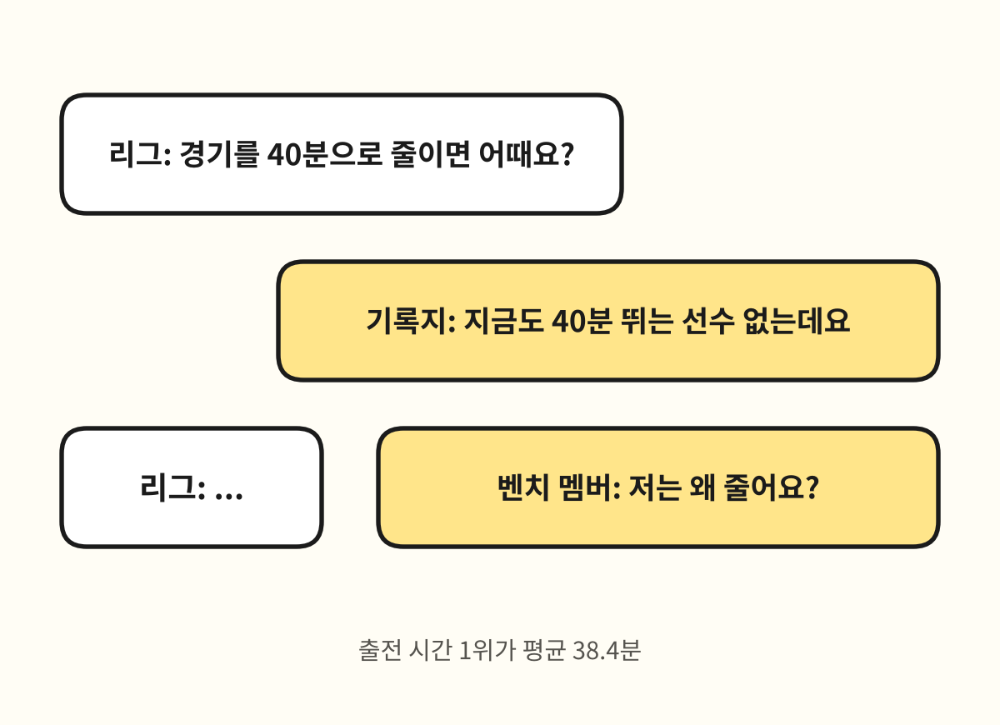

정규 시간이 17%쯤 줄긴 합니다. 근데 지금도 평균 40분을 뛰는 선수가 없어요. 스타의 출전 시간은 그대로고 벤치 몫만 줄어들 가능성이 큽니다. 문제는 코트에 서 있는 시간의 길이가 아니라, **그 시간이 얼마나 센지와 그 사이에 얼마나 쉬는지**예요.

## 맺으며

부상은 보통 "운이 없었다"로 끝납니다. 그런데 운이 매번 같은 방향으로만 없으면, 그건 운이 아니라 구조예요.

농구는 더 빠르고, 더 넓고, 더 재밌어졌습니다. 그 값을 선수들 무릎이 내고 있다면, 답은 "옛날 느린 농구로 돌아가자"가 아니라 **"지금 농구를 버틸 수 있는 일정과 준비를 만들자"**겠죠.

우리 리그 얘기도 하나만. 11월 12일 밤 기준으로 16개 팀 로스터에 결장 표시가 붙은 선수가 21명, 그중 **11명이 드래프트 1~3라운드 선수**입니다. 상위 48명 중 거의 넷에 한 명이에요. 단장님들에게는 IL 한 칸이지만, 그 한 칸마다 한 선수의 시즌이 걸려 있습니다. 다들 건강하게 돌아오길 바랍니다.

## 출처

- 2026-27시즌 일별 Out 등록·부위별 누적 결장, 시즌별 주전 결장 경기, 2025-26시즌 부위별 자료: 매거진 정리 자료(11월 13일 기준) · 원자료 [NBA 공식 부상 보고서](https://official.nba.com/nba-injury-report-2026-27-season/), [HoopsMatic 부상 기록](https://hoopsmatic.com/injury-history/), [HoopsMatic 방법론](https://hoopsmatic.com/injury-history/about/)
- 우리 리그 결장 표시 선수 수: Yahoo 리그 팀 페이지 야간 라인업 수집본(11월 12일 밤), 매거진 드래프트 팩트시트
- NBA 부상 역학 연구(2013-14~2018-19): [Sports Health, 2024](https://journals.sagepub.com/doi/10.1177/19417381241258482)
- 휴식과 부상에 관한 NBA 보고서: [NBA.com](https://www.nba.com/news/nba-sends-data-load-management-study)
- 페이스 중앙값(2015-16, 2024-25, 2025-26시즌): [NBC Sports](https://www.nbcsports.com/nba/news/injuries-to-nba-star-players-are-up-this-season-steve-kerr-says-pace-spacing-of-modern-game-to-blame)
- 그래프: 위 자료로 매거진이 그림
- 짤: 매거진이 직접 그림(기존 이미지를 가져오지 않음)
- 스텝백 3점 시도 증가율: [ESPN(ABC13 게재)](https://abc13.com/post/is-james-harden-leading-a-revolution-or-is-he-step-back-marching-the-nba-into-an-offensive-wasteland/6398335/)
- 35세 이상 선수의 출전 시간 비중: [Statitudes (2024년 7월)](https://www.statitudes.com/p/old-guards-new-tricks)
- 아킬레스건 파열 선수의 나이, AAU 경험 비율, 2024-25시즌 7건 영상 검토: USA TODAY, "From Tatum to Haliburton, why are Achilles injuries surging in the NBA?" (2025년 11월 7일) · 플레이오프 세 선수의 나이: [AP(theScore 게재)](https://www.thescore.com/nba/news/3304236)
- 아킬레스건 파열 건수, 출전 부담 연구와 리그의 반박: [Bleacher Report](https://bleacherreport.com/articles/25461382-nba-responds-study-relates-heavy-workloads-achilles-injuries)
- 30년 하지 근육·힘줄 부상 추세: [AAOS 2026 초록](https://index.mirasmart.com/AAOS2026/PDFfiles/AAOS2026-005022.pdf)
- Pandya 인터뷰, 백투백 횟수, 이동 거리 추세, 다종목 연구: [Sports Illustrated (2026년 10월 29일)](https://www.si.com/nba/why-nba-injury-problem-how-it-can-be-fixed)
- 이동 거리·속도·페이스와 Kerr 발언: [ESPN (2025년 11월)](https://www.espn.com.au/nba/story/_/id/47015001/kerr-concerned-nba-increased-pace-leading-injuries)
- 스타 결장 213경기와 전체 부상 추세: [USA TODAY(AOL 게재)](https://www.aol.com/articles/number-injured-nba-stars-rises-105833133.html), [NBC Sports](https://www.nbcsports.com/nba/news/injuries-to-nba-star-players-are-up-this-season-steve-kerr-says-pace-spacing-of-modern-game-to-blame)
- Silver 총재 발언과 리그의 반론: [Front Office Sports](https://frontofficesports.com/nba-schedule-cup-adam-silver-injuries)
- 오프시즌 훈련과 캠프 연장 제안: [Forbes (2026년 11월 6일)](https://forbes.com/sites/markmedina/2026/11/06/nba-early-season-injuries-call-for-need-to-modify-game-and-training)
- 40분 경기 논의: [HoopsHype](https://www.hoopshype.com/story/sports/nba/rumors/2026/11/04/mannix-adam-silver-likes-the-idea-of-40-minute-nba-games/92607321007/), [BVM Sports](https://bvmsports.com/2026/11/05/should-the-nba-cut-games-to-40-minutes-amid-injury-crisis/)
- Curry 부상: [TSN(ESPN)](https://www.tsn.ca/nba/article/warriors-curry-out-at-least-two-weeks-with-oblique-tear-n1-50462899/) · Markkanen 부상: [NBA.com](https://www.nba.com/news/lauri-markkanen-to-be-reevaluated-in-4-weeks), [ESPN](https://www.espn.com/nba/story/_/id/50454130/sources-jazz-star-lauri-markkanen-least-1-month)
