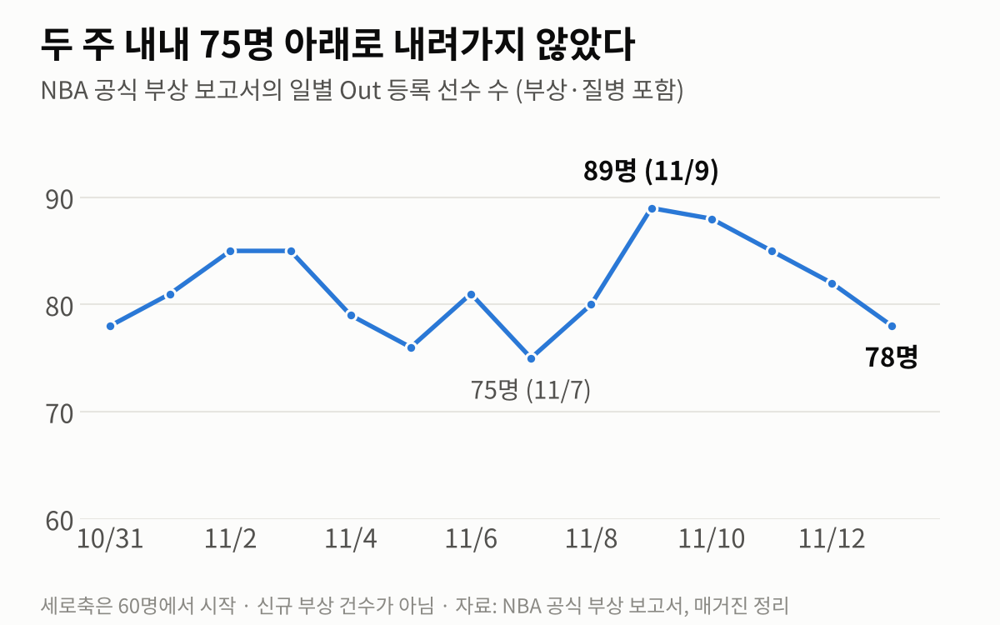
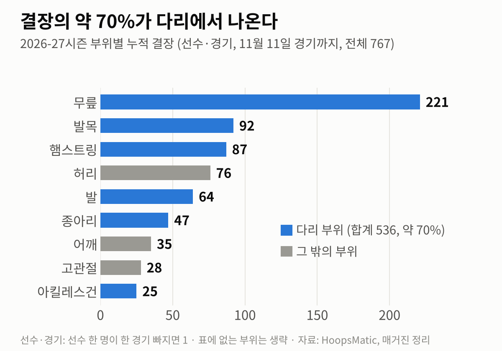
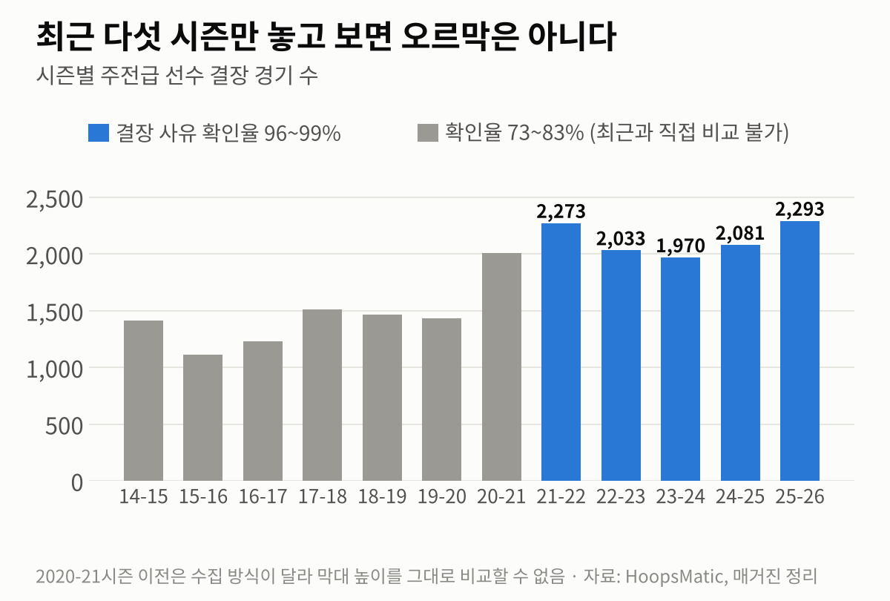
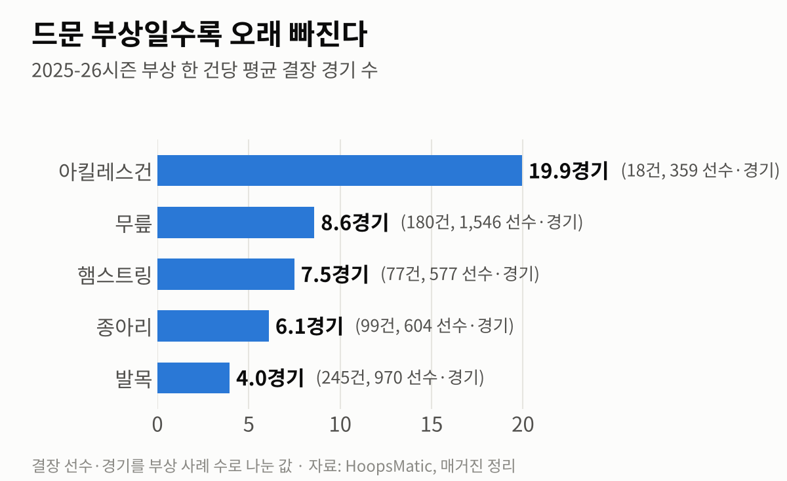
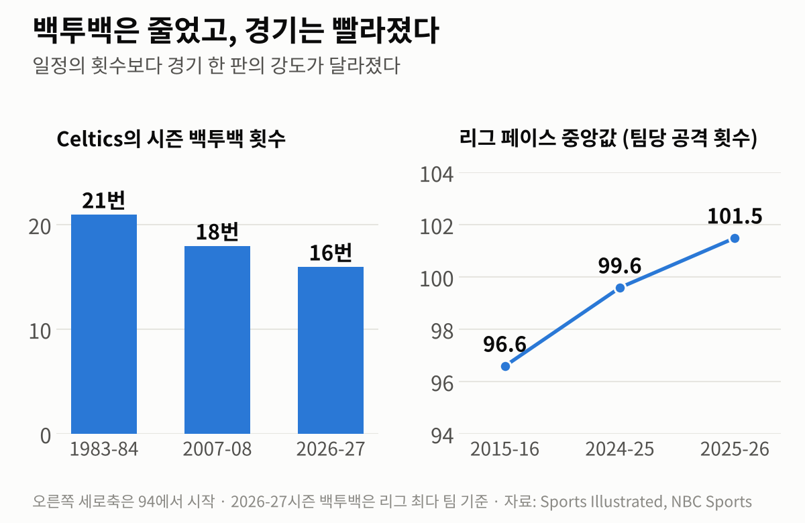

11월 11일 휴스턴. Stephen Curry가 1쿼터에 28피트 3점을 넣고는 옆구리를 잡은 채 벤치를 불렀습니다. 다음 날 나온 진단은 복사근 파열, 2주 뒤 재검진입니다. Curry가 다친 바로 그날, Utah는 Lauri Markkanen의 오른손에서 골절 두 곳을 확인했다고 발표했습니다. 4주 뒤 재검진입니다.

두 소식이 유난히 무겁게 들린 건 이미 명단이 길었기 때문입니다. Anthony Edwards, Tyrese Haliburton, Kawhi Leonard, Paolo Banchero, Jaren Jackson Jr., Chet Holmgren, Ja Morant, Jalen Duren. 개막 3주가 지나기도 전에 "부상 위기"라는 말이 나왔고, 경기를 40분으로 줄이자는 이야기까지 다시 나왔습니다.

이 글은 평소보다 조금 진지하게 갑니다. 정말 부상이 늘었는지, 늘었다면 왜인지, 그리고 무엇을 바꿔야 하는지를 차례로 따져 보겠습니다.

> **이 글의 기준**
> - 2026-27시즌 수치는 **11월 13일 기준**이며, NBA 공식 부상 보고서와 HoopsMatic 집계를 정리한 매거진 자료입니다.
> - **선수·경기**는 선수 한 명이 한 경기를 빠지면 1로 세는 단위입니다. 새로 다친 건수와는 다릅니다.
> - 그 밖의 연구와 보도는 글 끝 출처에 모았습니다.

## 1. 먼저, 정말 늘었는가

지금 확실히 말할 수 있는 것부터 적습니다.

- **11월 11일 경기까지 부상으로 인한 누적 결장은 767 선수·경기**입니다.
- 공식 보고서에 **Out으로 등록된 선수는 11월 9일 89명**까지 올랐다가 11월 13일 78명입니다. 10월 31일 이후 두 주 동안 75명 아래로 내려간 날이 없습니다.
- 부위별로는 **무릎 221**, 발목 92, 햄스트링 87, 허리 76, 발 64, 종아리 47, 어깨 35, 고관절 28, 아킬레스건 25입니다. 무릎·발목·햄스트링·발·종아리·아킬레스건을 합치면 536으로, **전체의 약 70%가 다리**입니다.

그런데 "역대 최악"이라고 쓰려면 한 가지가 더 필요합니다. **같은 시점, 같은 정의로 센 과거 시즌 숫자**입니다. 그게 지금은 없습니다.

주전급 선수의 결장 경기 수는 2023-24시즌 1,970경기에서 2025-26시즌 2,293경기로 두 해 사이 약 16% 늘었습니다. 다만 2021-22시즌도 2,273경기였으니 곧게 뻗은 오르막은 아닙니다. 그리고 2020-21시즌 이전은 결장 사유가 확인되는 비율이 73~83%에 그쳐(최근은 96~99%) 그 시절과 지금을 한 줄에 놓고 비교할 수 없습니다. 10년 전보다 몇 퍼센트 늘었다는 식의 문장은 조심해서 읽어야 하는 이유입니다.

리그 자체 연구도 같은 방향을 가리킵니다. NBA의 의무 기록을 분석한 2024년 논문은 2014-15시즌부터 2018-19시즌까지 결장으로 이어진 부상 발생률이 1만 선수·분당 5.6~7.0건으로 통계적으로 달라지지 않았다고 보고했습니다. 적어도 2019년까지는 "해마다 는다"는 근거가 없었던 셈입니다. 작년 이맘때도 비슷한 논쟁이 있었습니다. 스타 선수들의 결장은 개막 15경기 기준 213경기로 두 시즌 전(100경기)의 두 배를 넘었지만, 전체 부상 건수는 늘지 않았다는 분석이 함께 나왔습니다.

그래서 이 글의 출발점은 이렇습니다. **전체 부상이 늘었다는 건 아직 증명되지 않았습니다. 그러나 스타들이 빠지는 경기가 늘고 있고, 그 부담이 다리와 근육·힘줄에 몰려 있다는 건 여러 자료가 함께 말합니다.** 부상 "건수"보다 부상 "부담"의 문제입니다.

지난 시즌 부위별 자료가 그 차이를 보여 줍니다. 발목은 245건으로 가장 흔했지만 한 건에 평균 4경기쯤 빠졌습니다. 무릎은 180건에 1,546경기, 한 건에 8.6경기입니다. 아킬레스건은 18건뿐인데 359경기, **한 건에 약 20경기**가 사라졌습니다. 드물게 일어나는 큰 부상 몇 건이 한 시즌의 풍경을 바꿉니다.

## 2. 가설 하나: 멈추고 꺾는 동작

첫 번째 가설은 농구 자체가 달라졌다는 것입니다. 게더 스텝, 스텝백, 유로스텝. 현대 공격의 핵심 기술은 모두 **달리던 몸을 한 발로 급하게 세우는 동작**입니다. 빨리 달리는 것보다 빨리 멈추는 것이 무릎과 발목, 햄스트링에 더 큰 부담을 준다는 건 생체역학에서 널리 받아들여지는 이야기입니다.

정황도 있습니다. 올 시즌 결장의 약 70%가 다리에 몰려 있고, 상대와 부딪히지 않고 혼자 멈추거나 뛰어오르다 다치는 장면이 반복됩니다. 30년 치 공개 부상 기록을 본 올해 학회 발표는 아킬레스건·햄스트링·종아리 부상이 아이솔레이션 공격과 빠른 전환 농구가 자리 잡은 시기에 뚜렷하게 늘었다고 보고했습니다.

하지만 이 가설에는 빈칸이 있습니다. **스텝백이 실제로 얼마나 늘었는지, 그 동작을 많이 하는 선수가 더 많이 다치는지를 직접 보여 주는 공개 자료가 없습니다.** 그리고 모든 부상을 설명하지도 못합니다. Markkanen의 골절은 상대 손에 맞아서 생겼습니다. 리그 연구에 따르면 결장으로 이어진 부상의 73%가 급성이고, 그중 절반 가까이는 다른 선수와의 접촉에서 나옵니다. 개연성은 높지만 아직 증명된 가설은 아닙니다.

## 3. 가설 둘: 오래 지배하는 스타와 쌓이는 주행거리

두 번째 가설은 누적입니다. 지금 리그의 얼굴들은 유난히 오래 정상에 있습니다. Curry는 38세이고, 30대 후반에도 팀의 중심인 선수가 여럿입니다. 커리어 누적 출전 시간과 과거 부상 이력이 위험 요인이라는 건 리그 연구진도 인정합니다.

다만 나이만으로는 설명이 안 됩니다. 올 시즌 명단에는 20대 초중반이 가득합니다. UCSF의 정형외과 의사 Nirav Pandya는 아킬레스건과 햄스트링 부상이 예전에는 커리어 후반의 부상이었는데 이제는 젊은 선수에게서 나타난다고 지적합니다. 그가 꼽는 이유는 유소년 시절입니다. 어릴 때부터 1년 내내 농구만 하는 조기 전문화가 자리 잡으면서, **지금의 스무 살은 30년 전의 스무 살보다 이미 더 많은 거리를 뛴 몸**이라는 겁니다. Adam Silver 총재도 지난 시즌 부상 원인을 묻는 질문에 경기 속도와 함께 유소년 농구의 빡빡한 일정을 언급했습니다.

그러니 이 가설은 "스타가 늙어서"가 아니라 "몸에 쌓인 총량이 많아서"로 고쳐 읽는 편이 맞습니다. 이를 확인하려면 나이, 누적 출전 시간, 사용률, 과거 부상을 함께 넣은 분석이 필요한데, 공개된 자료로는 아직 할 수 없습니다.

## 4. 가설 셋: 일정

가장 자주 지목되는 범인은 82경기입니다. 그런데 자료는 조금 다른 이야기를 합니다.

우선 백투백은 오히려 줄었습니다. 1983-84시즌 Celtics는 백투백이 21번, 2007-08시즌에는 18번이었고, 올 시즌 리그 최다인 Celtics가 16번입니다. NBA가 2024년 30개 구단에 보낸 57쪽짜리 보고서는 한발 더 나아가, 휴식을 위한 결장이 이후 부상 위험을 낮춘다는 근거를 찾지 못했고 일정이 빡빡한 구간이나 그 직후에 부상률이 높지도 않았다고 결론 냈습니다. 연구진은 "휴식이 소용없다는 뜻은 아니다"라고 선을 그었지만, 적어도 **경기 수를 줄이면 부상이 준다는 직접 증거는 아직 없습니다.**

그렇다고 일정이 무죄라는 뜻은 아닙니다. 바뀐 건 경기 수가 아니라 **경기 한 판의 무게**입니다. 지난 시즌 초반 선수 추적 자료에서 선수들의 경기당 이동 거리 합계(34.3마일)와 평균 속도(시속 4.43마일)는 2013-14시즌 측정을 시작한 이래 가장 높았고, 리그 평균 페이스는 1988-89시즌 이후 가장 빨랐습니다. 올 시즌 Bucks의 이동 거리는 2013-14시즌 1위였던 Spurs보다 시즌 기준 약 77마일 많을 추세입니다.

Steve Kerr 감독의 지적이 이 지점을 짚습니다. 예전에는 닷새에 네 경기를 치르는 대신 그 뒤에 나흘을 쉬었습니다. 지금은 몰아치는 구간을 없앤 대신 **이틀에 한 번꼴로 쉼 없이 경기가 이어집니다.** 회복할 날도, 제대로 훈련할 날도 없다는 겁니다. 그래서 일정 가설은 "82경기가 많다"보다 "더 무거워진 경기를 예전 간격으로 치른다"로 다시 써야 합니다. 총량이 아니라 밀도, 이동, 휴식일의 문제입니다.

## 5. 가설 넷: 준비되지 않은 채 시작하는 시즌

마지막 가설은 지금 이 시기와 가장 잘 맞습니다. 누적 피로로는 **개막 3주 만에** 쏟아지는 부상을 설명하기 어렵기 때문입니다.

Pandya는 개막 직후 부상이 조금 느는 건 NBA, NFL, NHL 모두에서 흔한 일이라고 말합니다. 몸이 실전 속도에 다시 적응하는 시기라는 겁니다. 리그 연구에서도 결장으로 이어진 부상 발생률이 가장 높은 건 정규시즌이 아니라 **프리시즌 경기**였습니다. 준비 상태와 경기 강도 사이의 틈이 벌어질 때 몸이 버티지 못한다는 신호입니다.

그 틈은 넓어지고 있습니다. 프리시즌 경기는 줄었고, 오프시즌 훈련은 풀코트 실전보다 개인 기술 위주로 바뀌었습니다. 반면 개막전의 속도는 해마다 빨라집니다. 여기에 현대 수비가 더해집니다. 코트 위 다섯 명이 모두 3점을 쏘니 수비수는 25피트 밖까지 나가야 하고, 스위치와 클로즈아웃 때마다 전력으로 달렸다가 멈춰야 합니다. 가설 하나의 "멈추는 동작"은 공격수만의 일이 아닙니다.

이 가설 역시 공개 자료만으로는 크기를 잴 수 없습니다. 하지만 시즌 초반에 부상이 몰리는 현상을 가장 자연스럽게 설명합니다.

## 6. 네 가설을 겹쳐 보면

네 가설은 서로 경쟁하지 않습니다. 겹칩니다.

**더 빠르고 더 넓어진 농구가 한 번의 감속에 실리는 부담을 키웠고(가설 하나), 선수들은 어릴 때부터 쌓인 주행거리를 안고 리그에 들어오며(가설 둘), 무거워진 경기를 회복할 틈 없이 이틀에 한 번 치르고(가설 셋), 그 강도를 충분히 준비하지 못한 채 개막을 맞습니다(가설 넷).** 부상은 이 넷이 만나는 자리에서 일어납니다.

솔직하게 덧붙이면, 여기까지는 "가장 그럴듯한 설명"이지 입증된 인과관계가 아닙니다. 전 선수 단위의 부상 기록, 선수별 노출량, 동작 추적 원자료는 리그와 구단만 가지고 있습니다. 바깥에서 할 수 있는 건 정황을 맞춰 보는 일까지입니다.

## 7. 그래서, 무엇을 바꿔야 하는가

원인이 하나가 아니니 처방도 하나일 수 없습니다. 다만 증거의 무게를 따라가면 방향은 보입니다. **경기를 줄이는 것보다, 경기와 경기 사이를 고치는 것**입니다.

**첫째, 총량보다 간격을 손봐야 합니다.** 82경기를 줄이자는 주장은 직관적이지만 근거가 약하고, 수입이 걸려 있어 현실성도 낮습니다. 반대로 같은 82경기를 더 긴 기간에 펼쳐 백투백을 없애고 경기 사이에 24~48시간을 보장하는 안은 근거와 현실성을 함께 갖췄습니다. 시즌을 조금 일찍 시작하거나 늦게 끝내면 됩니다. 스타가 더 많은 경기에 나서니 리그의 사업에도 손해가 아닙니다.

**둘째, 시즌의 입구를 넓혀야 합니다.** 부상이 가장 잦은 구간이 프리시즌과 개막 직후라면, 줄여야 할 것은 준비 기간이 아니라 준비와 실전 사이의 낙차입니다. 훈련캠프를 늘리고, 캠프 전부터 풀코트 실전 훈련을 단계적으로 쌓고, 개막 초반 일정에는 백투백과 긴 원정을 덜 배치하는 방식입니다. 부하를 급하게 올릴 때 근육과 힘줄이 다치기 쉽다는 건 스포츠의학에서 오래 받아들여져 온 원칙입니다.

**셋째, 쉬게 하는 대신 맞춤으로 관리해야 합니다.** 건강한 선수를 일괄적으로 쉬게 하는 로드 매니지먼트는 리그 연구에서 효과가 확인되지 않았습니다. 같은 연구가 위험 요인으로 꼽은 것은 나이, 과거 부상, 수술 이력입니다. 그렇다면 관리의 단위는 "팀 전체의 휴식일"이 아니라 "이 선수의 이력과 지금 상태"여야 합니다. 종아리 통증이 아킬레스건 파열로 번지기 전에 영상 검사로 근육과 힘줄을 살피고, 복귀를 서두르지 않는 최근의 흐름은 옳은 방향입니다. 65경기 출전 규정처럼 아픈 선수를 코트로 떠미는 장치가 이 흐름과 충돌하지 않는지도 점검해야 합니다.

**넷째, 몸을 만드는 시기를 바꿔야 합니다.** 가장 오래 걸리지만 가장 근본적인 처방입니다. 고등학교 때 여러 종목을 한 NBA 선수가 덜 다치고 더 오래 뛰었다는 연구가 있습니다. 유소년 단계의 연중무휴 일정과 조기 전문화를 줄이는 일은 리그 혼자 할 수 없지만, 리그가 먼저 말을 꺼내야 하는 일입니다.

**다섯째, 측정하고 공개해야 합니다.** 지금의 논쟁이 공전하는 이유는 같은 숫자를 보고 있지 않기 때문입니다. 지난 시즌 리그는 스타 결장이 줄었다고 했고, 바깥에서는 늘었다고 했습니다. 선수 노출량당 부상 발생률, 개막 후 같은 경기 수 기준의 시즌 비교, 접촉과 비접촉의 구분. 이 세 가지만 매년 같은 정의로 공개돼도 "늘었나"를 두고 다투는 시간을 "어떻게 줄이나"에 쓸 수 있습니다.

경기를 40분으로 줄이는 안은 이 목록에 넣지 않았습니다. 정규 시간이 17%쯤 줄어들지만, 지금도 평균 40분을 뛰는 선수는 없습니다. 스타의 출전 시간은 그대로이고 벤치의 몫만 줄어들 가능성이 큽니다. 문제는 코트 위에 있는 시간의 길이가 아니라, 그 시간의 강도와 그 사이의 회복입니다.

## 맺으며

부상은 운의 영역으로 여겨지곤 합니다. 하지만 운이 한 방향으로만 반복되면 그건 구조입니다. 농구는 더 빠르고, 더 넓고, 더 아름다워졌습니다. 그 대가를 선수의 무릎과 힘줄이 치르고 있다면, 돌아가야 할 곳은 예전의 느린 농구가 아니라 **지금의 농구를 견딜 수 있는 일정과 준비**입니다.

우리 리그도 이 문제에서 자유롭지 않습니다. 11월 12일 밤 기준으로 16개 팀 로스터에 결장 표시가 붙은 선수는 21명, 그 가운데 **11명이 드래프트 1~3라운드에 뽑힌 선수**입니다. 상위 세 라운드 48명 중 거의 넷에 한 명꼴입니다. 판타지 단장에게 부상은 IL 한 칸의 문제이지만, 그 한 칸마다 한 선수의 시즌이 걸려 있습니다. 모두 건강하게 돌아오길 바랍니다.

## 출처

- 2026-27시즌 일별 Out 등록·부위별 누적 결장, 시즌별 주전 결장 경기, 2025-26시즌 부위별 자료: 매거진 정리 자료(11월 13일 기준) · 원자료 [NBA 공식 부상 보고서](https://official.nba.com/nba-injury-report-2026-27-season/), [HoopsMatic 부상 기록](https://hoopsmatic.com/injury-history/), [HoopsMatic 방법론](https://hoopsmatic.com/injury-history/about/)
- 우리 리그 결장 표시 선수 수: Yahoo 리그 팀 페이지 야간 라인업 수집본(11월 12일 밤), 매거진 드래프트 팩트시트
- NBA 부상 역학 연구(2013-14~2018-19): [Sports Health, 2024](https://journals.sagepub.com/doi/10.1177/19417381241258482)
- 휴식과 부상에 관한 NBA 보고서: [NBA.com](https://www.nba.com/news/nba-sends-data-load-management-study)
- 페이스 중앙값(2015-16, 2024-25, 2025-26시즌): [NBC Sports](https://www.nbcsports.com/nba/news/injuries-to-nba-star-players-are-up-this-season-steve-kerr-says-pace-spacing-of-modern-game-to-blame)
- 그래프: 위 자료로 매거진이 그림
- 30년 하지 근육·힘줄 부상 추세: [AAOS 2026 초록](https://index.mirasmart.com/AAOS2026/PDFfiles/AAOS2026-005022.pdf)
- Pandya 인터뷰, 백투백 횟수, 이동 거리 추세, 다종목 연구: [Sports Illustrated (2026년 10월 29일)](https://www.si.com/nba/why-nba-injury-problem-how-it-can-be-fixed)
- 이동 거리·속도·페이스와 Kerr 발언: [ESPN (2025년 11월)](https://www.espn.com.au/nba/story/_/id/47015001/kerr-concerned-nba-increased-pace-leading-injuries)
- 스타 결장 213경기와 전체 부상 추세: [USA TODAY(AOL 게재)](https://www.aol.com/articles/number-injured-nba-stars-rises-105833133.html), [NBC Sports](https://www.nbcsports.com/nba/news/injuries-to-nba-star-players-are-up-this-season-steve-kerr-says-pace-spacing-of-modern-game-to-blame)
- Silver 총재 발언과 리그의 반론: [Front Office Sports](https://frontofficesports.com/nba-schedule-cup-adam-silver-injuries)
- 오프시즌 훈련과 캠프 연장 제안: [Forbes (2026년 11월 6일)](https://forbes.com/sites/markmedina/2026/11/06/nba-early-season-injuries-call-for-need-to-modify-game-and-training)
- 40분 경기 논의: [HoopsHype](https://www.hoopshype.com/story/sports/nba/rumors/2026/11/04/mannix-adam-silver-likes-the-idea-of-40-minute-nba-games/92607321007/), [BVM Sports](https://bvmsports.com/2026/11/05/should-the-nba-cut-games-to-40-minutes-amid-injury-crisis/)
- Curry 부상: [TSN(ESPN)](https://www.tsn.ca/nba/article/warriors-curry-out-at-least-two-weeks-with-oblique-tear-n1-50462899/) · Markkanen 부상: [NBA.com](https://www.nba.com/news/lauri-markkanen-to-be-reevaluated-in-4-weeks), [ESPN](https://www.espn.com/nba/story/_/id/50454130/sources-jazz-star-lauri-markkanen-least-1-month)
