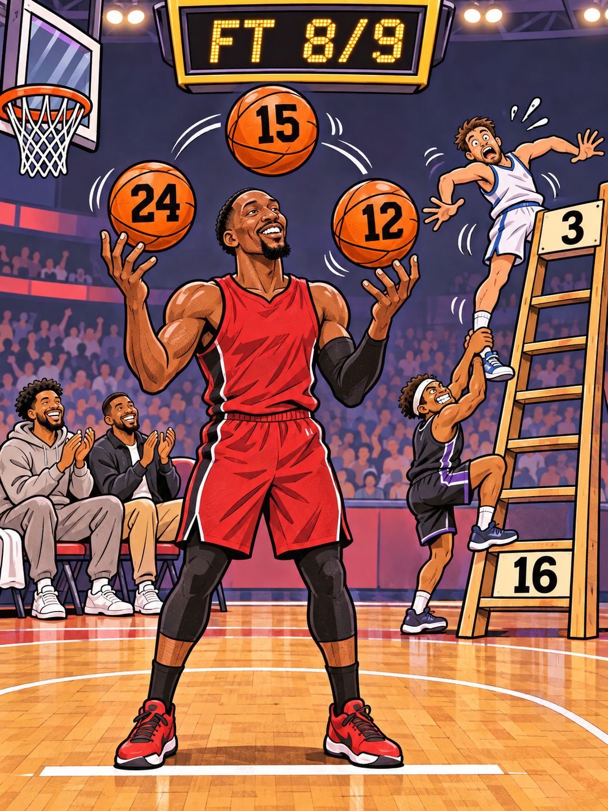
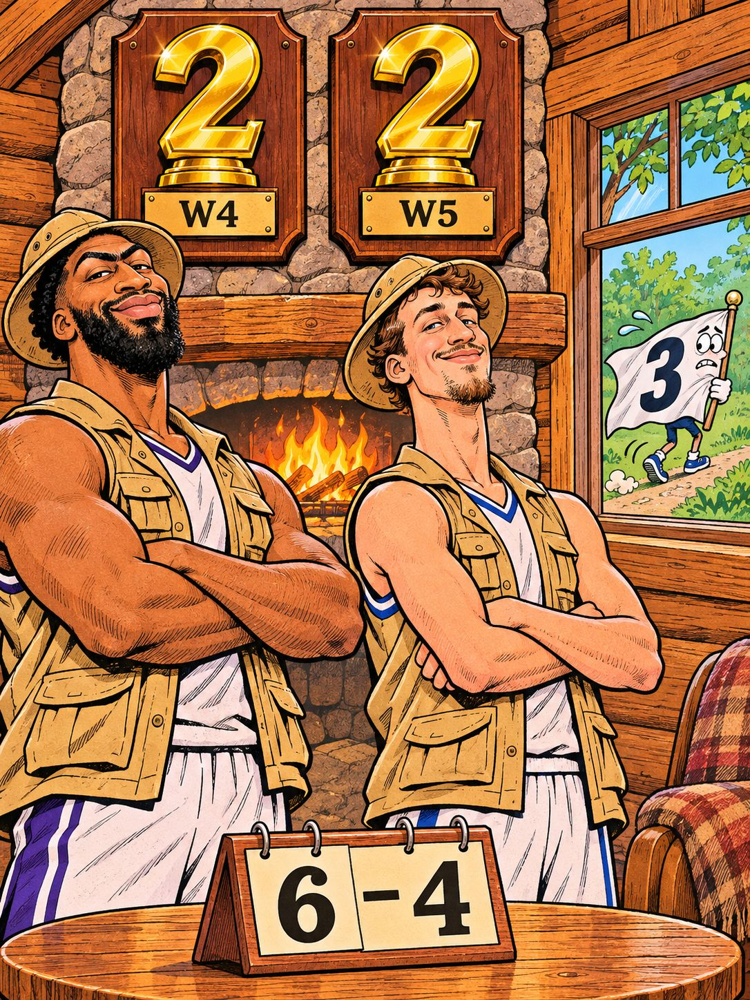
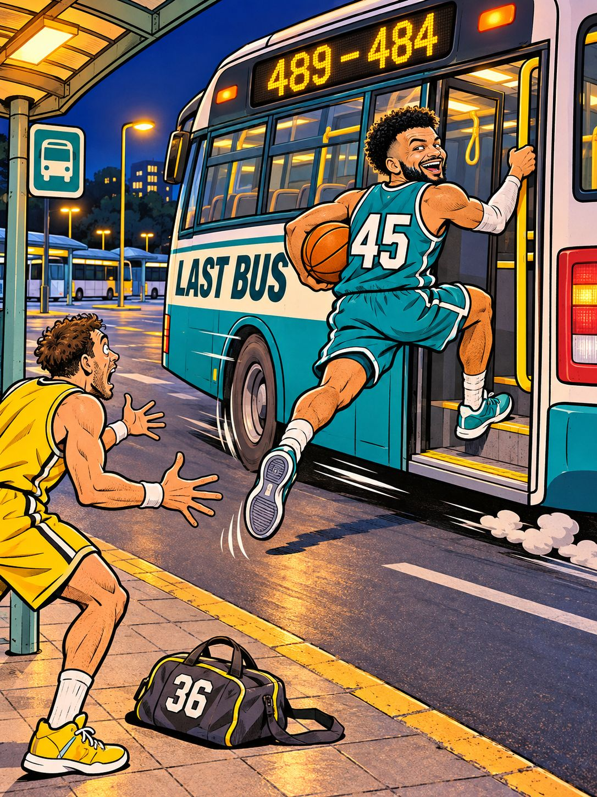

에이스 둘이 쉰 날, 24점 15리바운드 12어시스트에 자유투 8/9. 16위 SEOB's가 3위의 발목을 잡았습니다💪

지난주엔 14위로, 이번 주엔 12위로. 2위 자리에 앉으면 Hanseong's가 찾아옵니다. 3위는 벌써 짐을 쌌어요🏹

36점 앞서 있었는데 막차에 45점이 탔습니다. 최종 489 대 484, 종점에 닿기 전엔 내린 게 아니에요🚌
